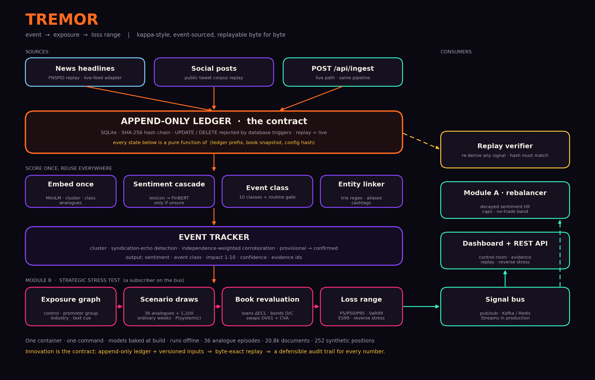

# TREMOR - S&P Global & Crisil Campus Hackathon

**Candidate Name:** Lakshya Manchanda
**College Email ID:** lmanchanda_be23@thapar.edu
**College / Campus:** Thapar Institute of Engineering and Technology
**Demo Video Link:** *(add unlisted YouTube link)*
**Slide Deck Link (if hosted externally):** in-repo, [docs/presentation.pdf](docs/presentation.pdf)

> A headline names one company. TREMOR shows a bank the loss on its whole book, including the obligors the
> headline never named, with a range and a trail back to the sources, and it can prove how it got the number.

## 1. Project Overview / Problem Statement & Approach

**Problem.** The case asks for a text-to-risk pipeline: ingest unstructured text from at least two sources and emit a
structured signal (sentiment score, event class, impact score), then drive a downstream module. Underneath, a risk officer asks
a harder question: *"If this headline is real, what does it do to **our** book, how sure are we, and can I show the auditor how we got the number?"*
Generic sentiment feeds cannot answer it: reposts look like evidence, rumours fire alerts, stress tests are periodic and
detached from news, and nothing is traceable.

**Approach.** News headlines and social posts are appended to a hash-chained, append-only **ledger**. Each item is embedded once,
scored by a sentiment cascade (finance lexicon first, FinBERT only when unsure), classified into 10 event classes (plus a routine
gate) and linked to companies. Items are clustered into **events**: syndicated copies are detected and never count as independent
evidence, social volume is capped, and an event stays *provisional* until independent credible publishers corroborate it.
**Module B** then maps the event onto a synthetic wholesale book through an **exposure graph** (parent/subsidiary, promoter group,
industry peers, rule-based text cues), draws scenarios from 36 documented historical episodes mixed with ordinary weeks
according to P(systemic | class), and revalues loans, bonds and swaps by Monte Carlo into a P5/P50/P95 loss range with reverse stress.
**Module A** (a tactical rebalancer) is a second subscriber on the same signal bus.

**Why it is different.** The contribution is the *contract*: an append-only ledger plus versioned inputs, so any signal can be
re-derived byte for byte (the dashboard's *Replay* button does exactly that and compares hashes). We also report what did **not** work
([docs/LIMITATIONS.md](docs/LIMITATIONS.md)).

## 2. Architecture & Tech Stack



* **Core:** Python 3.11, FastAPI, Pydantic contracts, NumPy/pandas, SQLite ledger.
* **NLP:** `all-MiniLM-L6-v2` (one embedding for clustering, class, novelty, analogues), FinBERT (`ProsusAI/finbert`) behind a lexicon cascade, trie-compiled entity linker.
* **Risk:** vectorised Monte Carlo; credit triangle (spread ≈ PD×LGD); loans ΔECL, bonds duration/convexity/spread-duration, swaps DV01 + CVA.
* **UI:** dependency-free HTML/CSS/JS (canvas + SVG), fonts bundled locally so it runs offline.
* **Quality:** 36 pytest tests (including replay exactness and tamper detection), ruff, GitHub Actions CI, Docker (CPU-only torch, models baked in).

```
src/tremor/   ledger · ingest · nlp · scoring · events · entities · analogues · book · stress · engine · modules · api · backtest · evaluate · web/
data/         corpus (replay), analogues (36 episodes + ordinary weeks), market (betas, calibration), book, results, entities.csv
scripts/      fetch_market · build_analogues · build_corpus · make_architecture · make_deck
docs/         presentation.pdf · architecture.png · LIMITATIONS.md · EVALUATION.md · DEMO_SCRIPT.md
```

## 3. Dataset Used

All data is public or synthetic; **no confidential or client data** (see [data/NOTICE.md](data/NOTICE.md)).

| Data | Source | Notes |
|---|---|---|
| News headlines (≈5k) | FNSPID (CC BY-NC 4.0) | publisher + date; 2020-04-09 to 2020-07-16 |
| Social posts (≈16k) | `StephanAkkerman/stock-market-tweets-data` (CC BY 4.0) | replayed as a historical stream; no live X API |
| Market prices | Yahoo Finance via `yfinance` | cached; spreads are ETF proxies |
| Analogue library | 36 episodes (2008-2025), author-written descriptions, shocks measured from prices | |
| Book | **synthetic**, seeded (252 positions, 102 obligors, ~USD 18.7bn) | real names are labels only |

**Assumptions:** news is day-resolution (15:00 UTC assumed), so no minute-level lead/lag claims; ratings, LGD, tenors and swap sides are invented; delisted names lack prices. Full list in [docs/LIMITATIONS.md](docs/LIMITATIONS.md).

## 4. Quickstart & Installation

Runtime: Python 3.11 (tested on Windows 11) or Docker.

**Docker (one command):**
```bash
git clone <your-repo-url>
cd <repo-folder>
docker compose up --build
```
Open <http://localhost:8000>, pick an episode in the header and press play. Models and the scored corpus are baked in at build time; the container needs no network at run time.

**Local:**
```bash
git clone <your-repo-url>
cd <repo-folder>
python -m venv .venv && source .venv/bin/activate        # Windows: .venv\Scripts\activate
pip install torch --index-url https://download.pytorch.org/whl/cpu
pip install -r requirements-dev.txt && pip install --no-deps -e .
python -m tremor.warm        # one-off: embeds + scores the replay corpus (~3 min on CPU)
python -m tremor.api         # http://localhost:8000
```
Tests and checks: `pytest` · `ruff check src tests scripts` · `python -m tremor.backtest` · `python -m tremor.evaluate`.
Live path: `curl -X POST localhost:8000/api/ingest -H "content-type: application/json" -d '{"text":"...","source":"news","publisher":"reuters.com"}'`.

## 5. Key Results & Domain Impact

Measured, out of sample (details: Proof tab in the app, [docs/EVALUATION.md](docs/EVALUATION.md)):

* **Calibration.** On 30 historical episodes (chronological, no look-ahead; 150 scored intervals) the predicted 50/80/90% bands cover 45% / 74% / 85% of realised market moves.
* **Skill.** The systemic-vs-idiosyncratic mixture improves pinball loss by **+7.5%** over drawing every event from the crisis library (+18% vs ordinary weeks), positive on all five market targets. Peer-aware prediction beats no-graph by about 8% on pinball loss.
* **NLP.** On 2,388 labelled posts the cascade reaches **74.8%** accuracy (FinBERT-only 65.5%, lexicon-only 73.7%) while calling FinBERT on only **24%** of items. Event-vs-routine F1 is 0.78. Manual link audit: 70/70 correct identities.
* **Pipeline.** 20,836 documents → 6,123 events; 32% of news items were syndicated copies and were collapsed; about 5 ms per document including Monte Carlo.
* **Event study.** Across 103 single-name events, Impact has a modest positive rank-correlation with the stock's same-day |abnormal return| (ρ = 0.23, p = 0.02). Direction accuracy is inconclusive (56%, n = 16).
* **Replay.** Every emitted signal re-derives to an identical hash from the ledger (enforced by tests).

**Honest negatives.** Sharper analogue retrieval did not beat the unconditional history at n = 36; the Impact Score is a transparent triage score, not a calibrated forecast; promoter-group contagion cannot be backtested (one episode); entity-link recall against noisy ticker tags is low (32%).

**Why it matters.** Risk teams get a triaged, book-specific, auditable first estimate within seconds, with an explicit statement of uncertainty, as a complement to (not a replacement for) surveillance and supervisory stress testing.

## Licence

MIT. Data licences differ and are listed in [data/NOTICE.md](data/NOTICE.md).
